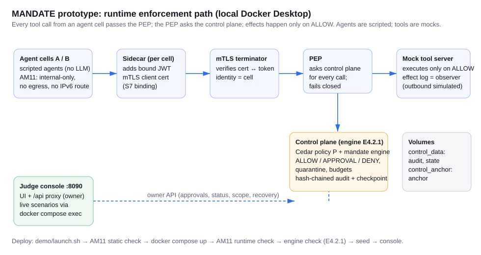

# MANDATE: judge quick start

MANDATE is a runtime-governance prototype for AI agents. Every tool call an agent makes passes a Policy Enforcement Point (PEP). The PEP asks a control plane, which enforces the agent's declared mandate:
- role, task, sensitivity, destinations and delegation scope;
- structured HR scope;
- exact amounts and spend limits;
- read budgets.

The control plane also detects behavioural drift. It answers **ALLOW**, **APPROVAL_REQUIRED** (held until the owner approves) or **DENY**, and can quarantine an agent. Tool effects happen only on ALLOW.

**What this is and is not.** It is a local prototype:
- agents are scripted (no LLM);
- the tool server is a mock, and outbound effects are simulated;
- all testing is AI self-review on one machine.

It is not production-ready, not SECURITY-TESTED and not independently reviewed. Known limitations are listed in the console (Evaluation results) and in `FINAL_STATUS_REPORT.md`.

## Requirements (validated environment)

- Windows 11, Docker Desktop (validated 29.8.2), Git Bash, Python ≥ 3.10 on the host (validated with 3.12 and 3.14). Nothing else is installed on the host.
- Docker image `mandate-spike-py312:wave2` (see *Building the image*). The pinned nginx image is pulled automatically.
- No cloud account, LLM key or external credential is needed.

## Start (one command)

```bash
bash demo/launch.sh
```

Run it from `validation/prototype` in Git Bash. It does the following:
1. preflight: Docker, Python, images, port;
2. deploy with the AM11 cell-isolation gates (static check → `docker compose up` → runtime check; it refuses if a gate fails);
3. confirm that the control plane reports engine **E4.2.1** (selected explicitly; the repository default is E2);
4. seed the declared demo agents;
5. start the console.

Then open **http://127.0.0.1:8090**. Stop everything with:

```bash
bash demo/stop.sh
```

The console holds the **demo** owner token for you (`MANDATE_CONSOLE_DEMO_TOKEN=1`). It listens on 127.0.0.1 only. The control-plane API itself (127.0.0.1:8800) still requires the owner token.

## What to look at (about 10 minutes)

The console has four areas. Plain-language explanations come first, and the technical evidence is always one click away.

1. **Home** answers what MANDATE is, how it works (ask → check → decide) and why it matters. It shows the latest live checkpoint decision, the current state (agents, approvals, audit), a plain-language feed of decisions, and the honest headline results.
2. **See it work**
   - **Guided scenarios**: 12 live stories in four chapters (Everyday work, Attacks stopped, Humans in control, When things go wrong). Each run shows the steps, MANDATE's decision in words, the checks verified at the tool server, and *what this proves*.
   - **Try an attack**: pick a preset such as *Steal salaries by email*, or write your own, and the real engine says what it would decide. It's a dry run: nothing executes or is recorded.
   - **Live AI agent** (optional): a real model under MANDATE. It needs your own key; see below.
3. **Operate**
   - **Agents & mandates**: who may do what. Quarantine, restrict or resume (with a reason), and assign tasks, including declared HR scope.
   - **Approvals**: held actions waiting for you. Approve once or reject; the outcome shows whether it ran.
   - **Decisions**: every decision, explained, with a verifiable evidence-pack export.
   - **Attack map**: every agent → action → destination path, coloured by outcome.
4. **Proof**
   - **Results**: what we measured, with denominators.
   - **Audit trail**: the hash chain, verified, with filters.
   - **Known limits**: the full register.
   - **Recovery**: the three recovery states.
   - **System health**: services, engine and recorded checks.

Hover any dotted-underlined term (*mandate*, *checkpoint*, *quarantine*…) for a definition. The ◐ button switches light and dark mode. The status pill at the top right is live, and clicking it opens System health.

**Reset to baseline:** See it work → Guided scenarios → *Reset demo* (redeploys through the AM11 gates and reseeds, about 1 minute), or run `bash demo/stop.sh && bash demo/launch.sh`.

## Optional: live LLM agent

The base demo needs no key. To let a **real model** (Groq, `openai/gpt-oss-120b`) plan the agent's tool calls, set the key in **your own terminal** first. Don't put it in a file or paste it into chat:

```bash
export GROQ_API_KEY=your-key
export MANDATE_LLM_CONSENT=1
bash demo/launch.sh
```

Then open **Live LLM agent** in the console. The three tasks are normal procurement work, reading the poisoned supplier quote, and web research followed by a wiki write.

- The model runs on the host. Every tool call it proposes goes through the real cell → PEP → control plane path, so the cells stay network-isolated.
- The verdict comes only from the tool server's effect log. The model's behaviour varies from run to run, so results are shown per run, not as a rate.
- Sent to Groq: the task prompt, the tool list and the mock tool results.

## Architecture



| Component | Where | Role |
|---|---|---|
| Agent cells A/B | `compose.yaml` (`agent_a`, `agent_b`), `pep/agent_proto.py` | Scripted agents in AM11-isolated network namespaces. |
| Sidecar + mTLS terminator | `../S7-binding` configs | Bind each call to the cell's identity (certificate + token). |
| PEP | `pep/pep_proto.py` | Asks the control plane for every call; fails closed. |
| Control plane | `control/server.py`, engine `mandate/engine_e421.py`, state `mandate/state_e42.py`, policy `../S2-cedar/config` | Decisions, approvals, quarantine, hash-chained audit, durable checkpoint, recovery. |
| Mock tool server | `pep/backend_proto.py` | Executes on ALLOW only. Its effect log is the independent observer. |
| Judge console | `console/console.py`, `console/static/` | UI, owner-API proxy, live scenarios, reset, recovery, diagnostics, results. |

## Tests and evidence

| What | Command | Recorded result |
|---|---|---|
| Engine regression | `docker run --rm --network none -v "$(cygpath -w "$(pwd)/.."):/v" -w /v/prototype mandate-spike-py312:wave2 python -m unittest tests.test_engine_e421` | 60/60 (`tests/runs/`) |
| Live E2E | `MANDATE_ENGINE=E4.2.1 bash run_prototype.sh e2e` | 17/17 (`e2e/runs/`) |
| Console integration (live) | `python console/tests/test_console_integration.py` (with the demo running) | `console/tests/runs/` |
| Evidence integrity | `python ../tools/verify_evidence.py verify` | 0 changed / 0 missing |

## Building the image (only if `mandate-spike-py312:wave2` is missing)

```bash
cd ../images/spike-py312 && docker build -t mandate-spike-py312:wave2 .
```

The build fetches pinned Cedar and cvc5 binaries, and Python packages from PyPI. The exact transitive pins, with hashes, are in `../images/spike-py312/lock/requirements.lock.txt`. A rebuild from the lock has not been verified on a second machine.

## Troubleshooting

| Symptom | Fix |
|---|---|
| `PREFLIGHT FAILED: Docker daemon not reachable` | Start Docker Desktop and wait until it says *running*. |
| `image mandate-spike-py312:wave2 missing` | Build it (above). |
| `deployment refused` / `AM11 runtime gate did not pass` | Look at `e2e/runs/<latest>-console/deploy.log` and `cell_policy_runtime.json`. Run `bash demo/stop.sh`, then launch again. |
| `control plane reports engine 'E2'` | Another stack is running without the launcher. Run `bash demo/stop.sh`, then `bash demo/launch.sh`. |
| Red banner *Control plane unreachable* | Expected right after journey 11 or 12. For 11, open **Recovery** or **Reset demo**. Otherwise see `docker compose -f compose.yaml logs control`. |
| Port 8090 in use | Stop the other program, or set `MANDATE_CONSOLE_PORT` and start `python console/console.py` yourself. |
| Scenario shows FAIL with a precondition note | Earlier runs left a different state (for example, after recovery). Use **Reset demo**. |
